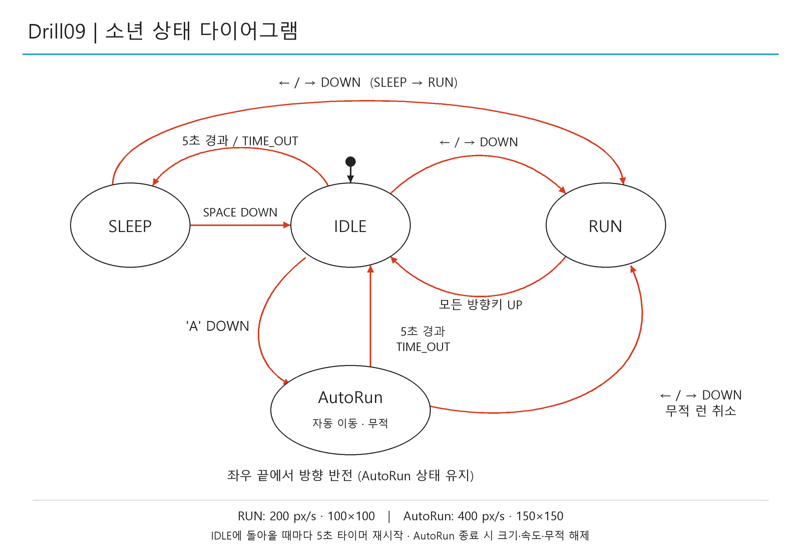
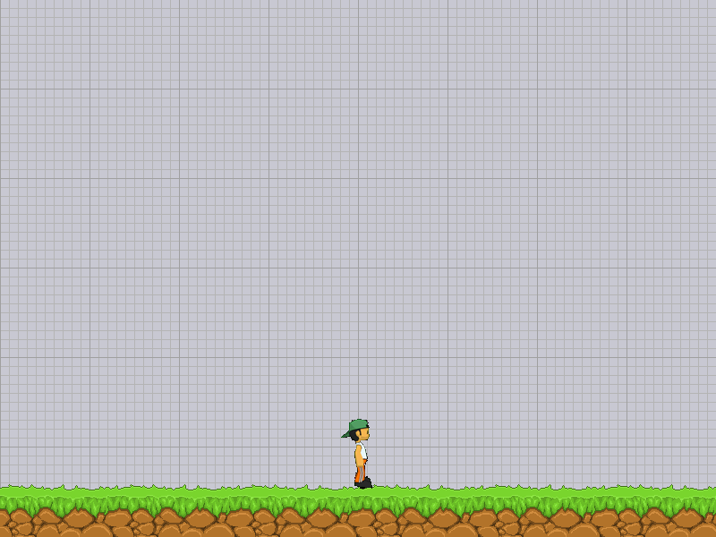
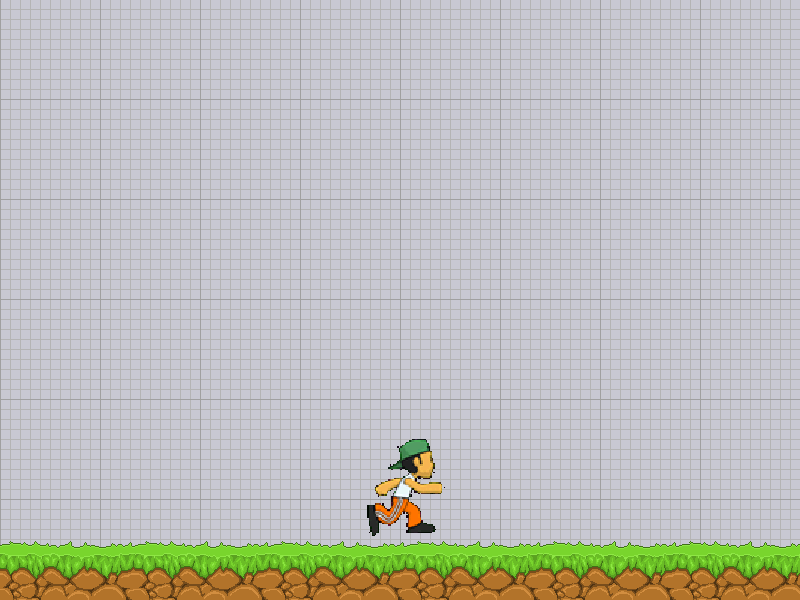
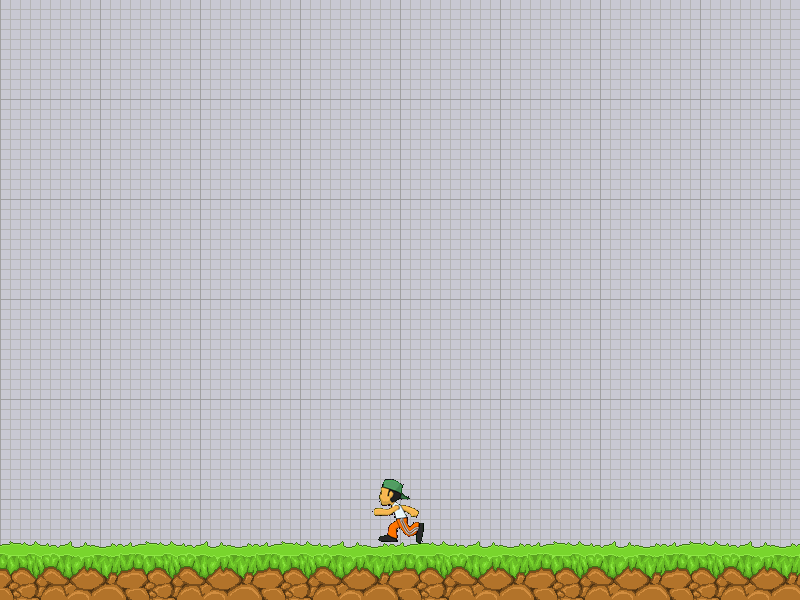

# Drill09 - AutoRun 캐릭터 컨트롤러

기존 IDLE / SLEEP / RUN 구조를 확장했습니다. `AutoRun`은 별도의 상태 클래스이며
`auto_run.py`에서 진입, 종료, 자동 이동, 시간 제한과 그리기를 담당합니다.
상태 전환은 기존 `transitions`의 `GraphMachine`으로 관리합니다.

## 실행

Drill09 저장소 루트에서 실행합니다.

```powershell
python -m pip install -r Labs/LEC12_CharacterController/requirements.txt
python Labs/LEC12_CharacterController/main.py
```

이미지는 소스 파일 위치를 기준으로 읽으므로 다른 작업 폴더에서도 실행할 수 있습니다.
소년은 800×600 화면의 잔디 중앙 `(400, 90)`에서 시작합니다.

## 조작과 상태

| 현재 상태 | 입력 또는 조건 | 다음 상태 / 동작 |
|---|---|---|
| IDLE | A 누름 | AutoRun, 마지막에 바라보던 방향으로 자동 이동 |
| IDLE | 좌우 방향키 누름 | RUN |
| IDLE | 5초 경과 | SLEEP |
| SLEEP | SPACE 누름 | IDLE |
| SLEEP | 좌우 방향키 누름 | RUN |
| RUN | 모든 좌우 방향키를 놓음 | IDLE |
| AutoRun | 키 입력 없음 | 자동 이동 유지 |
| AutoRun | 화면 좌우 끝 도달 | 같은 상태에서 방향 반전 |
| AutoRun | 진입 후 5초 이상 경과 | IDLE |
| AutoRun | 좌우 방향키 누름 | 무적 런 취소, 눌린 방향의 일반 RUN |
| 전체 | ESC 또는 창 닫기 | 종료 |

좌우 방향키를 함께 누르면 마지막에 누른 방향이 우선합니다.
하나를 놓아도 다른 방향키가 눌려 있으면 RUN을 유지합니다.
A는 IDLE에서만 작동하며, AutoRun 중 다시 눌러도 타이머가 연장되지 않습니다.
IDLE에 돌아올 때마다 대기 타이머를 새로 시작합니다.

| 항목 | 일반 RUN | AutoRun |
|---|---:|---:|
| 속도 | 200 px/s | 400 px/s (2배) |
| 출력 크기 | 100×100 | 150×150 (1.5배) |
| 무적 플래그 `boy.invincible` | False | True |
| 화면 끝 | 정지 | 자동 방향 반전 |
| 지속 시간 | 방향키를 누르는 동안 | 최대 5초 |

AutoRun이 끝나거나 취소되면 `exit()`에서 크기와 무적 플래그를 복구합니다.
일반 속도는 RUN의 이동 코드에서 다시 적용됩니다. 현재 예제에는 적이나 피해 판정이 없으며,
무적 여부는 `boy.invincible`로 제공합니다.
확대 시 발 위치를 유지하고, 확대된 프레임 전체가 화면 안에 있도록 경계를 계산합니다.
SLEEP은 원래 100×100 크기로 뒤로 누워 얼굴이 위를 향하게 그립니다.

## 상태 다이어그램

강의 PDF처럼 타원 상태와 빨간 전환 화살표를 사용했습니다.



- [PNG 이미지](docs/state_diagram.png)
- [SVG 원본](docs/state_diagram.svg)
- [실제 GraphMachine 전환에서 추출한 Mermaid 원본](docs/state_diagram.mmd)

이미지를 다시 만들려면 Pillow를 설치한 뒤 실행합니다.

```powershell
python -m pip install Pillow
python Labs/LEC12_CharacterController/generate_state_diagram.py
```

Windows의 맑은 고딕을 기본으로 사용합니다. 다른 환경에서는 `--font 한글폰트경로`를 지정합니다.

## 파일 구성

| 파일 | 역할 |
|---|---|
| `main.py` | 이벤트 전달, 월드 갱신, 실행 루프 |
| `boy.py` | GraphMachine 상태 전환, 일반 이동, IDLE/SLEEP 그리기 |
| `auto_run.py` | 별도 `AutoRun` 상태 클래스 |
| `grass.py` | 잔디 그리기 |
| `animation_sheet.png`, `grass.png` | 실행에 필요한 강의 이미지 |
| `generate_state_diagram.py` | PNG / SVG / Mermaid 재생성 |
| `tests/test_boy.py` | 상태, 속도, 크기, 경계, 타이머 자동 검사 |
| `tests/render_smoke.py` | 실제 Pico2D 렌더링과 이미지 로딩 검사 |

## 검증

```powershell
python -m unittest discover -s Labs/LEC12_CharacterController/tests -v
python Labs/LEC12_CharacterController/tests/render_smoke.py
```

12개 자동 검사로 진입, 자동 이동, 양쪽 경계 반사, 큰 프레임 간격,
5초 만료, 양쪽 방향키 취소, 크기 복구, SLEEP/SPACE, 반복 입력을 확인했습니다.
SDL의 오프스크린 렌더링으로 실제 이미지 로딩과 세 상태의 출력도 확인합니다.

| IDLE | AutoRun | 취소 후 RUN |
|---|---|---|
|  |  |  |
